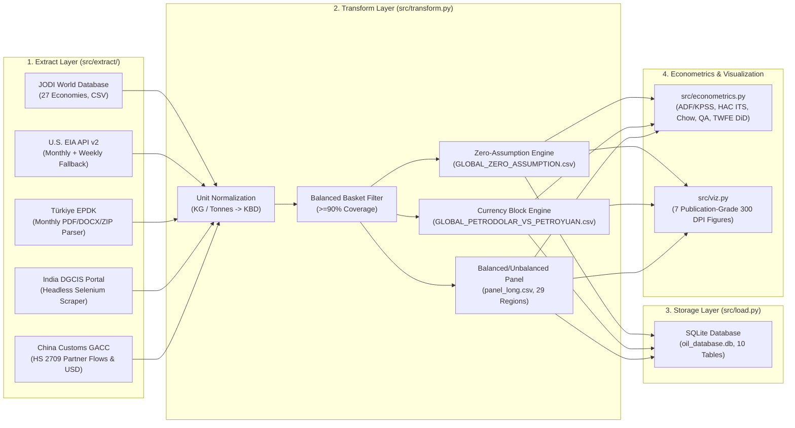

# ProjectOil: Sanctions, Trade Reallocation, and Petroyuan Settlement in Global Crude Oil Markets (2018–2026)

> **An End-to-End Automated Data Engineering Pipeline and Econometric Research Framework**  
> **Sample Period:** January 2018 – February 2026 ($N = 98$ months; $49$ pre-invasion, $49$ post-invasion)  
> **Panel Coverage:** $29$ economies $\times$ $98$ months ($2,842$ country-month observations)

---

## Executive Summary

Following the February 2022 invasion of Ukraine, Western financial sanctions, maritime embargoes, and the G7/EU \$60/bbl price cap fundamentally reshaped global crude oil trade routes and settlement currencies. **ProjectOil** is an automated ETL (Extract–Transform–Load) and econometric modeling pipeline built in Python to quantify two interrelated questions:

1. **Physical Trade Reallocation (Zero-Assumption Pillar):** To what extent did global crude oil flows structurally pivot from traditional Western routes toward China, India, and Türkiye using strictly official customs and regulatory data (with **zero currency-share assumptions**)?
2. **Currency Regime Shift (Petroyuan vs. Petrodollar Pillar):** How much of global crude oil trade migrated from USD-denominated settlement (**Petrodollar**) toward RMB/RUB/non-USD settlement (**Petroyuan / Alternative Block**), and do these findings hold when time-varying currency share assumptions are replaced with **constant-share (step-free)** benchmarks?

### Headline Empirical Findings ($2018\text{–}01$ to $2026\text{–}02$)

* **Global Crude Trade Volume Remained Stable ($+1.20\%$):** Covered global crude imports averaged **$38,893.8\text{ KBD}$** pre-war ($2018\text{–}01$ to $2022\text{–}01$) and **$39,359.0\text{ KBD}$** post-war ($2022\text{–}02$ to $2026\text{–}02$). First-difference Interrupted Time Series (ITS) confirms no permanent decline in global physical demand growth ($p = 0.9966$). Sanctions reallocated trade routes rather than destroying aggregate volume.
* **Zero-Assumption Sanctioned Crude Share More Than Doubled Globally:** Without applying any currency assumptions, the combined share of sanctioned crude imports into China, India, and Türkiye rose from **$4.81\%$ to $9.65\%$** ($2.01\times$, $p = 0.0008$) under the **Strict** definition (Russia + Iran + Venezuela) and from **$5.79\%$ to $12.54\%$** ($2.17\times$, $p = 0.0109$) under the **Broad** definition (including Malaysia transshipment flows) of covered global crude imports.
* **Massive National Reallocations:**
  * **India (`DGCIS / JODI`):** Russia's share of Indian crude imports surged nearly **$14\times$**, from **$2.22\%$** pre-war to **$30.55\%$** post-war (HAC level shift $= +17.11\text{ pp}$, $p < 0.0001$).
  * **Türkiye (`EPDK`):** Russia's share of Turkish crude imports jumped **$2.5\times$**, from **$17.42\%$** to **$43.29\%$** (HAC level shift $= +16.76\text{ pp}$, $p = 0.0018$; level-stationary $I(0)$, $\text{ADF } p = 0.0292$).
  * **China (`GACC`):** Direct Russian crude share rose from **$15.45\%$** to **$18.53\%$** ($+2.41\text{ pp}$ ITS shift, $p = 0.0045$; level-stationary $I(0)$, $\text{ADF } p < 0.0001$), while the **Broad** sanctioned basket (including Malaysian STS transshipment of Iranian/Venezuelan barrels) rose from **$21.95\%$** to **$28.81\%$** ($+9.67\text{ pp}$ ITS shift, $p < 0.0001$).
* **Endogenous Break Dates Match Sanctions Milestones:** Unknown-breakpoint Quandt-Andrews $\sup\text{-Wald}$ tests endogenously pinpoint **May 2022 (`2022-05`)** for China ($\sup\text{-Wald} = 164.47, p < 0.01$)—capturing the 60–90 day contract and voyage lag after February 2022—and **February–May 2023 (`2023-02` / `2023-05`)** for India and the global aggregate ($\sup\text{-Wald} = 105.90, p < 0.01$), coinciding with the EU maritime ban (December 2022) and G7 \$60 price cap enforcement.
* **Customs Price Discount Mechanism (`USD/bbl`):** Quantity-weighted unit values from Chinese customs (`GACC`) reveal that Russian crude traded at a **$+\$0.35/\text{bbl}$ premium** to unsanctioned benchmarks pre-war (reflecting proximity and ESPO grade quality) but flipped to an average **$-\$5.83/\text{bbl}$ discount** post-war ($\Delta = \$6.19/\text{bbl}$).
* **Cross-Validation Accuracy:** Independent cross-validation between Chinese Customs (`GACC`) and `JODI` China crude import totals across all $98$ months yields **$\text{Pearson } r = 0.9602$ ($p = 5.74 \times 10^{-55}$)**, **$\text{MAPE} = 1.12\%$**, and a median absolute discrepancy of **$0.12\%$**.

---

## 1. System Architecture & Data Engineering Pipeline

ProjectOil is architected as a modular, fault-tolerant ETL and econometrics system. Every transformation is implemented as a pure, unit-tested function operating on standardized units (**KBD — thousand barrels per day**, using $1\text{ metric ton} = 7.33\text{ barrels}$ and exact calendar days per month). Missing observations are never backfilled or forward-filled (`ffill` is strictly prohibited to prevent artificial autocorrelation).



### Primary Data Sources & Coverage

| Source | Institution | Coverage & Granularity | Role in Pipeline |
| :--- | :--- | :--- | :--- |
| **JODI** | Joint Organisations Data Initiative | $27$ countries, $2018\text{–}01$ to $2026\text{–}02$ (`CRUDEOIL`, `TOTIMPSB`, `KBD`) | Global constant-basket baseline (`JODI_DIGER_KBD`), India total imports (`IN`), and China cross-validation (`JODI_CN_KBD`). |
| **EIA** | U.S. Energy Information Administration | United States, $2018\text{–}01$ to $2026\text{–}02$ | Official U.S. crude oil imports (`ABD_Ithalat_KBD`), with automated weekly-to-monthly aggregation fallback. |
| **EPDK** | Energy Market Regulatory Authority (Türkiye) | $105$ monthly sector reports (`PDF`, `DOCX`, `XLSX`, `ZIP`) | Türkiye total crude imports (`TR_Toplam_Ithalat_KBD`) and Russian crude imports (`TR_Rusya_Ithalat_KBD`). |
| **DGCIS** | Directorate General of Commercial Intelligence & Statistics (India) | $59$ months ($2021\text{–}04$ to $2026\text{–}02$, `HS 27090000`) | India's physical crude imports from Russia (`IN_Russia_KBD`). Pre-$2021\text{–}04$ values are kept as `NaN` in zero-assumption series. |
| **GACC** | General Administration of Customs (China) | $101$ months ($3,213$ partner-month records, `Quantity_kg` & `USD`) | China partner-level crude imports (`Russia`, `Iran`, `Venezuela`, `Malaysia`, `Saudi Arabia`, `UAE`, `Iraq`, `Oman`, `Brazil`) and customs CIF unit prices (`USD/bbl`). |

---

## 2. Econometric Methodology

To ensure robustness against non-stationarity, serial correlation, and seasonality, every target series undergoes a six-stage econometric battery in [`src/econometrics.py`](src/econometrics.py):

### 2.1 Stationarity & Unit Root Testing
* **Level Series:** Augmented Dickey-Fuller (`ADF`, $H_0$: unit root) and Kwiatkowski–Phillips–Schmidt–Shin (`KPSS`, $H_0$: stationarity) with constant and linear trend (`regression='ct'`).
* **First-Differenced Series ($\Delta Y_t$):** `ADF` and `KPSS` with constant (`regression='c'`).

### 2.2 Interrupted Time Series (ITS) with Newey-West HAC Standard Errors
For structural break date $T_0 = \text{2022-02-01}$ ($\text{Post}_t = \mathbb{I}(t \ge T_0)$):

* **Level ITS Specification:**
  $$Y_t = \beta_0 + \beta_1 t + \beta_2 \text{Post}_t + \beta_3 \text{Post}_t (t - t_0) + \sum_{m=2}^{12} \gamma_m D_{m,t} + \varepsilon_t$$
  where $\beta_2$ (`post`) captures the immediate post-war level shift, $\beta_3$ (`post_trend`) captures the change in monthly slope, and $D_{m,t}$ are calendar month dummies.
* **First-Difference ITS Specification (Spurious-Regression Guard for $I(1)$ Series):**
  $$\Delta Y_t = \mu + c_d \Delta \text{Post}_t + d_d \text{Post}_{t-1} + \sum_{m=2}^{12} \phi_m D_{m,t} + u_t$$
  where $\Delta \text{Post}_t$ isolates the one-time impact jump at $T_0$ and $\text{Post}_{t-1}$ isolates the permanent change in monthly drift after $T_0$.
* **Inference:** Standard errors are estimated via Newey-West HAC with bandwidth $L = \lfloor 4(T/100)^{2/9} \rfloor = 3$ lags, accompanied by Durbin-Watson (`DW`), Breusch-Godfrey LM (`BG(3)`), and Breusch-Pagan (`BP`) diagnostics.

### 2.3 Structural Break Tests: Known (`Chow`) and Unknown (`Quandt-Andrews`)
* **Chow Test:** $F$-test for parameter stability at `2022-02` (both baseline $[1, t]$ and seasonally adjusted specifications).
* **Quandt-Andrews Unknown Breakpoint Test:** Scans all candidate break dates in the central $70\%$ of the sample ($\pi_0 = 0.15$ trimming) and computes $\sup\text{-}F$ and $\sup\text{-Wald} = k \cdot \sup\text{-}F$ ($k=2$), evaluated against **Andrews (1993, *Econometrica* Table 1)** asymptotic critical values ($10\%: 10.01$, $5\%: 11.79$, $1\%: 15.51$).

### 2.4 Two-Way Fixed Effects (TWFE) Panel DiD & Event Study
Across $N = 29$ countries and $T = 98$ months, we estimate via Frisch-Waugh-Lovell orthogonalization with country ($\alpha_i$) and year-month ($\lambda_t$) fixed effects and country-clustered standard errors:
$$Y_{it} = \alpha_i + \lambda_t + \delta (\text{Treated}_i \times \text{Post}_t) + \nu_{it}, \qquad \text{Treated}_i \in \{\text{CN}, \text{IN}\}$$
alongside a dynamic event-study specification ($k \in [-12, +24]$ relative to February 2022, reference period $k = -1$).

---

## 3. Empirical Results ($2018\text{–}01$ to $2026\text{–}02$)

### 3.1 Pillar I: Zero-Assumption Physical Trade Reallocation

The table below reports results from `outputs/econometrics_zero_assumption_report.txt`. Every series in this table is computed **directly from official physical import quantities** (`GACC`, `EPDK`, `DGCIS`, `JODI`, `EIA`) with **zero currency-share assumptions**:

| Zero-Assumption Series | Sample ($N_{\text{pre}}/N_{\text{post}}$) | Pre-War Mean | Post-War Mean | Order of Integration | Level ITS Shift (`post`, $p$) | Level ITS Slope (`post_trend`, $p$) | Chow $F$ (`2022-02`, $p$) | Quandt-Andrews Peak ($\sup\text{-Wald}$) |
| :--- | :---: | :---: | :---: | :---: | :---: | :---: | :---: | :---: |
| **China Russia Share (`GACC`, %)** | $49 / 49$ | $15.45\%$ | **$18.53\%$** | **$I(0)$** ($\text{ADF } p=0.0000$) | **$+2.410$** ($0.0045$) | $+0.020$ ($0.5336$) | $6.25$ ($0.0028$) | **`2022-05`** ($26.85^{***}$) |
| **China Strict Share (`Rus+Iran+Ven`, %)** | $49 / 49$ | $19.39\%$ | **$18.63\%$** | $I(1)$ ($\Delta\text{ADF } p=0.0000$) | **$+5.500$** ($0.0001$) | **$+0.299$** ($0.0000$) | $65.48$ ($1.5\text{e-}18$) | `2020-09` ($183.78^{***}$) |
| **China Broad Share (`+Malaysia`, %)** | $49 / 49$ | $21.95\%$ | **$28.81\%$** | $I(1)$ ($\Delta\text{ADF } p=0.0000$) | **$+9.673$** ($0.0000$) | **$+0.365$** ($0.0000$) | $60.08$ ($1.6\text{e-}17$) | **`2022-05`** ($164.47^{***}$) |
| **Türkiye Russia Share (`EPDK`, %)** | $49 / 49$ | $17.42\%$ | **$43.29\%$** | **$I(0)$** ($\text{ADF } p=0.0292$) | **$+16.757$** ($0.0018$) | $+0.357$ ($0.0946$) | $5.69$ ($0.0047$) | `2020-01` ($44.03^{***}$) |
| **Global Covered (`CN+TR Strict`, %)** | $49 / 49$ | $5.25\%$ | **$5.94\%$** | $I(1)$ ($\Delta\text{ADF } p=0.0000$) | **$+0.975$** ($0.0006$) | **$+0.064$** ($0.0000$) | $38.57$ ($5.9\text{e-}13$) | **`2022-05`** ($103.20^{***}$) |
| **Global Covered (`CN+TR Broad`, %)** | $49 / 49$ | $5.93\%$ | **$8.83\%$** | $I(1)$ ($\Delta\text{ADF } p=0.0000$) | **$+1.993$** ($0.0004$) | **$+0.086$** ($0.0000$) | $34.28$ ($6.6\text{e-}12$) | **`2022-05`** ($110.51^{***}$) |
| **India Russia Share (`DGCIS/JODI`, %)** | $10 / 49$ | $2.22\%$ | **$30.55\%$** | $I(1)$ ($\Delta\text{ADF } p=0.0000$) | **$+17.112$** ($0.0000$) | $-0.006$ ($0.9937$) | $8.70$ ($0.0005$) | **`2023-02`** ($105.90^{***}$) |
| **Global Zero-Assumption (`Strict`, %)** | $10 / 49$ | $4.81\%$ | **$9.65\%$** | $I(1)$ ($\Delta\text{ADF } p=0.0000$) | **$+2.272$** ($0.0008$) | $-0.041$ ($0.6896$) | $7.70$ ($0.0011$) | **`2023-05`** ($99.23^{***}$) |
| **Global Zero-Assumption (`Broad`, %)** | $10 / 49$ | $5.79\%$ | **$12.54\%$** | $I(1)$ ($\Delta\text{ADF } p=0.0000$) | **$+2.468$** ($0.0109$) | $-0.152$ ($0.2957$) | $7.15$ ($0.0017$) | **`2023-05`** ($97.62^{***}$) |

*Notes:* $^{***}$ denotes significance at the $1\%$ level against Andrews (1993) $\sup\text{-Wald}$ critical value ($15.51$). India and full Global Zero-Assumption series start in `2021-04` (earliest month available on the DGCIS portal).

#### Economic Interpretation of the Zero-Assumption Results
1. **Stationary Direct Proof (`CN` and `TR`):** Both China's direct Russian import share ($\text{ADF } t = -5.97, p < 0.0001$; $\text{KPSS } p = 0.10$) and Türkiye's Russian import share ($\text{ADF } t = -3.61, p = 0.0292$; $\text{KPSS } p = 0.10$) are **trend-stationary $I(0)$ in levels**. Their HAC level ITS shifts ($+2.41\text{ pp}$ in China and $+16.76\text{ pp}$ in Türkiye) are free from unit-root spurious regression concerns.
2. **Evidence of Transshipment via Malaysia (`Strict` vs. `Broad`):** In official GACC data, direct imports from Iran and Venezuela drop near zero after late 2020, causing `CN_Strict_Share_Pct` to show a break in `2020-09`. Once Malaysian imports are included (`CN_Broad_Share_Pct`)—reflecting well-documented ship-to-ship (STS) transfers off the coast of Malaysia—the series exhibits a $+9.67\text{ pp}$ jump ($p < 0.0001$) and a $+0.365\text{ pp/month}$ post-war trend acceleration, with Quandt-Andrews identifying `2022-05` ($\sup\text{-Wald} = 164.47$).
3. **Two-Wave Sanctions Transmission (`2022-05` vs. `2023-02/05`):** Unknown breakpoint tests reveal that physical trade diversion occurred in two distinct waves:
   * **Wave 1 (`2022-05`):** Immediate post-invasion redirection of Russian spot cargoes to China.
   * **Wave 2 (`2023-02` to `2023-05`):** Full-scale diversion of seaborne Urals crude from Europe to India and China after the EU maritime embargo (December 5, 2022) and G7 price cap took effect.

---

### 3.2 Customs Price Discount Mechanism (`GACC` Unit Values)

Using partner-level CIF customs value (`USD`) and physical mass (`Quantity_kg` converted at $7.33\text{ bbl/tonne}$), we compute the monthly quantity-weighted price spread between unsanctioned suppliers (Saudi Arabia, UAE, Iraq, Oman, Brazil, Indonesia) and Russian crude entering China:

$$\text{Discount}_t = P^{\text{Benchmark}}_t - P^{\text{Russia}}_t \quad (\text{USD/bbl})$$

| Dependent Series | Obs ($N$) | Pre-War Mean Spread | Post-War Mean Spread | Level $\hat{\beta}_{\text{spread}}$ (HAC SE) | Level $p$-value | Level $R^2$ |
| :--- | :---: | :---: | :---: | :---: | :---: | :---: |
| **China Russia Share (`%`)** | $98$ | $-\$0.35/\text{bbl}$ (premium) | **$+\$5.83/\text{bbl}$ (discount)** | **$+0.1070$** ($0.0639$) | $0.0942^*$ | $0.5316$ |
| **China Strict Share (`%`)** | $98$ | $-\$0.35/\text{bbl}$ (premium) | **$+\$5.83/\text{bbl}$ (discount)** | $+0.0892$ ($0.0761$) | $0.2415$ | $0.6475$ |
| **China Broad Share (`%`)** | $98$ | $-\$0.35/\text{bbl}$ (premium) | **$+\$5.83/\text{bbl}$ (discount)** | $+0.0867$ ($0.1665$) | $0.6025$ | $0.6772$ |

* **Economic Mechanism:** Prior to February 2022, Russian crude landed in China at a $\$0.35/\text{bbl}$ premium over Middle Eastern/Atlantic basin crudes due to shorter pipeline/Pacific tanker hauls (ESPO blend). Post-invasion, Russian crude swung to an average **$\$5.83/\text{bbl}$ discount** ($\Delta = +\$6.19/\text{bbl}$). Controlling for post-war level and trend dummies plus seasonality, each $\$10/\text{bbl}$ widening in the customs discount is associated with an additional $+1.07\text{ percentage point}$ increase in Russia's share of Chinese crude imports ($p = 0.0942$).

---

### 3.3 Pillar II: Petrodollar vs. Petroyuan Block & Constant-Share Robustness

In the currency-adjusted model (`outputs/econometrics_report.txt`), baseline estimates use literature-derived piecewise-constant alternative-currency settlement shares (`data/assumptions/*.csv`) with a $\pm 5\%$ post-2022 sensitivity band.

To address the methodological concern that **time-varying assumption schedules ("step functions") might artificially manufacture post-2022 slope changes**, Section 7 of our econometric suite introduces two strict counterfactuals:
1. **Strict (Sanctioned-Only):** Excludes Malaysia, Saudi Arabia, UAE, Brazil, Oman, and Indonesia (`alt_share = 0`), retaining only Russia, Iran, and Venezuela.
2. **Constant-Share (`Sabit Oran`, Step-Free $50\%$):** Fixes post-February 2022 alternative currency settlement at a flat $50\%$ across all post-war months for Russian/Iranian/Venezuelan crude, eliminating all post-2022 assumption step increases so that **post-war dynamics are driven $100\%$ by physical import volumes**.

| Target Series | Scenario / Specification | Level ITS Shift (`post`, $p$) | Level ITS Slope (`post_trend`, $p$) | 1st-Diff Impact Jump (`d_post`, $p$) | 1st-Diff Drift Change (`post_lag`, $p$) |
| :--- | :--- | :---: | :---: | :---: | :---: |
| **Global Petroyuan (`KBD`)** | Low ($-5\%$ band) | $+948.2$ ($0.000$) | $+87.64$ ($0.000$) | $+4.6$ ($0.963$) | **$+103.63$** ($0.001$) |
| **Global Petroyuan (`KBD`)** | **Baseline** | **$+1,106.2$** ($0.000$) | **$+95.64$** ($0.000$) | $+71.5$ ($0.508$) | **$+112.91$** ($0.001$) |
| **Global Petroyuan (`KBD`)** | High ($+5\%$ band) | $+1,553.1$ ($0.000$) | $+96.46$ ($0.000$) | $+363.2$ ($0.002$) | **$+116.11$** ($0.002$) |
| **Global Petroyuan (`KBD`)** | **Strict (Sanctioned-Only)** | **$+955.7$** ($0.000$) | **$+51.43$** ($0.000$) | **$+163.3$** ($0.000$) | **$+65.37$** ($0.010$) |
| **Global Petroyuan (`KBD`)** | **Constant-Share (Step-Free $50\%$)** | **$+1,416.6$** ($0.000$) | **$+19.85$** ($0.000$) | **$+675.8$** ($0.000$) | $+31.95$ ($0.142$) |
| **Petroyuan Share (`%`)** | **Baseline** | **$+2.895\text{ pp}$** ($0.000$) | **$+0.238\text{ pp}$** ($0.000$) | $+0.311\text{ pp}$ ($0.193$) | **$+0.271\text{ pp}$** ($0.001$) |
| **Petroyuan Share (`%`)** | **Strict (Sanctioned-Only)** | **$+2.477\text{ pp}$** ($0.000$) | **$+0.127\text{ pp}$** ($0.000$) | **$+0.499\text{ pp}$** ($0.000$) | **$+0.157\text{ pp}$** ($0.013$) |
| **Petroyuan Share (`%`)** | **Constant-Share (Step-Free $50\%$)** | **$+3.655\text{ pp}$** ($0.000$) | **$+0.047\text{ pp}$** ($0.000$) | **$+1.823\text{ pp}$** ($0.000$) | $+0.074\text{ pp}$ ($0.172$) |
| **Global Petrodollar (`KBD`)** | **Baseline** | $+1,354.0$ ($0.040$) | $+34.20$ ($0.129$) | **$-1,825.7$** ($0.000$) | $+0.55$ ($0.997$) |

#### Key Takeaway from the Decomposition
Even when all post-2022 currency-share step increases are removed (**Constant-Share $50\%$**), physical volume reallocation alone generates a highly significant **$+1,416.6\text{ KBD}$ ($+3.66\text{ pp}$, $p < 0.0001$) level shift** and a **$+675.8\text{ KBD}$ ($+1.82\text{ pp}$, $p < 0.0001$) first-difference impact jump**. Meanwhile, the first-difference monthly drift (`post_lag`) attenuates from $+0.271\text{ pp/month}$ ($p = 0.001$) in the baseline to $+0.074\text{ pp/month}$ ($p = 0.172$) under flat shares—cleanly separating the **one-time physical trade realignment** from the **gradual institutional adoption of local-currency settlement**.

---

### 3.4 Two-Way Fixed Effects (TWFE) Panel DiD & Event Study

Across $29$ countries over $98$ months ($2,686$ valid share observations):

* **TWFE DiD Estimate (`Country Petroyuan Share %`):** $\hat{\delta}_{\text{DiD}} = \mathbf{+16.38\text{ percentage points}}$ ($\text{Clustered SE} = 6.55$, $t = 2.50$, **$p = 0.0185$**, $R^2_{\text{within}} = 0.5736$).
* **TWFE DiD Estimate (`Country Petroyuan Volume KBD`):** $\hat{\delta}_{\text{DiD}} = \mathbf{+1,611.5\text{ KBD}}$ ($\text{Clustered SE} = 919.6$, $t = 1.75$, **$p = 0.0907$**, $R^2_{\text{within}} = 0.4481$).
* **Dynamic Event-Study Trajectory (`ref` $t = -1$, January 2022):**
  * $t = -12$ (`2021-02`): $+0.32\text{ pp}$ ($+30.8\text{ KBD}$)
  * $t = -6$ (`2021-08`): $-0.06\text{ pp}$ ($-5.4\text{ KBD}$)
  * $t = 0$ (`2022-02`, Invasion): **$+1.56\text{ pp}$** ($+148.7\text{ KBD}$)
  * $t = +6$ (`2022-08`): **$+7.59\text{ pp}$** ($+678.2\text{ KBD}$)
  * $t = +12$ (`2023-02`, EU Ban / Price Cap): **$+11.87\text{ pp}$** ($+1,096.6\text{ KBD}$)
  * $t = +24$ (`2024-02`): **$+22.02\text{ pp}$** ($+2,183.0\text{ KBD}$)

---

## 4. Generated Outputs & Visualizations

Running the pipeline populates `data/processed/` (including `oil_database.db`) and `outputs/`:

### Econometric Reports & Tables (`outputs/`)
* `econometrics_zero_assumption_report.txt` & `econometrics_zero_assumption_summary.csv` — Full stationarity, HAC ITS, Chow, Quandt-Andrews, GACC-JODI cross-validation, and price-discount regressions for all 9 zero-assumption series.
* `econometrics_report.txt` & `econometrics_summary.csv` — Petrodollar/Petroyuan block econometric report.
* `econometrics_sensitivity.csv` — 13-scenario robustness matrix ($\pm 5\%$ bands, Strict Sanctioned-Only, and Constant-Share 50%).
* `econometrics_discount_mechanism.csv` — Russian customs price discount (`USD/bbl`) HAC regression results.
* `econometrics_panel_summary.csv` & `econometrics_panel_event_study.csv` — TWFE Panel DiD and dynamic event-study coefficients.

### Publication Figures (`outputs/*.png`, 300 DPI)
1. `zero_assumption_shares.png` — National (`CN`, `IN`, `TR`) and global (`Strict` vs. `Broad`) zero-assumption sanctioned crude shares ($2018\text{–}2026$).
2. `china_russia_discount_vs_share.png` — Dual-axis plot of China's Russian crude price discount (`USD/bbl`) vs. Russian import share (`%`).
3. `panel_did_event_study.png` — TWFE dynamic event-study coefficients and $95\%$ country-clustered confidence intervals ($t = -12\text{ to }+24$).
4. `petrodolar_vs_petroyuan_global.png` — Global Petrodollar vs. Petroyuan volume trajectories with $\pm 5\%$ post-2022 uncertainty bands.
5. `petroyuan_share_global.png` — Global Petroyuan share (`%`) with structural break marker.
6. `china_yuan_dolar_oran_trend.png` — China crude import settlement currency split (`%`).
7. `hindistan_genel_hacim_odeme_trend_guncel.png` — India Russian crude settlement breakdown (`%`).

---

## 5. Future Research & Senior Thesis Roadmap: External Currency Verification

Because customs authorities (`GACC`, `DGCIS`, `EIA`) report all merchandise trade values converted into USD rather than invoicing currency, direct customs data proves **physical trade reallocation** (`Pillar I`) and **price discount mechanisms**, while currency settlement (`Pillar II`) relies on institutional share schedules. For a senior undergraduate or master's thesis, the zero-assumption physical series in `GLOBAL_ZERO_ASSUMPTION.csv` can be directly paired with three **official macro-financial series** to verify de-dollarization without country-level `alt_share` assumptions:

1. **Bank of Russia (CBR) Export Currency Breakdown:** Official monthly/quarterly shares of USD/EUR, RUB, and "Friendly Currencies" (predominantly RMB) in Russian export receipts.
2. **PBOC / SAFE Cross-Border RMB Settlement & CIPS Volume:** Official People's Bank of China statistics on RMB share in Chinese cross-border goods trade.
3. **Shanghai International Energy Exchange (`INE SC` Crude Futures):** Monthly trading volume and open interest of RMB-denominated crude oil futures relative to Brent/WTI benchmarks.

---

## 6. Reproducibility & Quick Start

### 1. Environment Setup
```bash
python -m venv .venv
source .venv/bin/activate
pip install -r requirements.txt
cp .env.example .env   # Add your EIA_API_KEY
```

### 2. Running the Pipeline
```bash
# Full pipeline (Extract all 5 sources -> Transform -> Load SQLite -> Econometrics -> Plots)
python main.py

# Update specific source(s) only (e.g., EPDK or DGCIS) and re-run downstream analytics
python main.py --sources epdk

# Re-run Transform, SQLite Load, Econometrics, and Plots using local raw/cached files
python main.py --skip-extract

# Re-run Econometric Tests and Visualizations only
python main.py --only-analysis
```

### 3. Running the Automated Test Suite
The repository includes **35 offline unit and end-to-end integration tests** covering HTML/PDF/DOCX/ZIP parsing, AJAX DOM race conditions in Selenium, balanced JODI baskets, unit conversions, FWL panel orthogonalization, and full pipeline execution:
```bash
pytest -v -W default
```

---

## Repository Structure

```text
ProjectOil/
├── main.py                          # CLI entrypoint & pipeline orchestrator
├── requirements.txt                 # Python dependencies
├── data/
│   ├── assumptions/                 # Literature currency-share schedules (CSV)
│   ├── raw/                         # Cached EPDK docs & GACC annual CSVs
│   └── processed/                   # Standardized KBD CSVs & oil_database.db
├── outputs/                         # Econometric reports (.txt/.csv) & 300 DPI figures (.png)
├── src/
│   ├── config.py                    # Central dates, constants, and file contracts
│   ├── units.py                     # Calendar-aware KG/Tonnes <-> KBD conversions
│   ├── transform.py                 # Pure functional transformations & Zero-Assumption engine
│   ├── load.py                      # Atomic SQLite loader with metadata tracking
│   ├── econometrics.py              # ADF/KPSS, HAC ITS, Chow, Quandt-Andrews, TWFE DiD & Event Study
│   ├── viz.py                       # Matplotlib/Seaborn visualization suite
│   └── extract/                     # Modular extractors (jodi, eia, epdk, dgcis, gacc)
└── tests/                           # 35 unit and E2E pipeline tests
```
